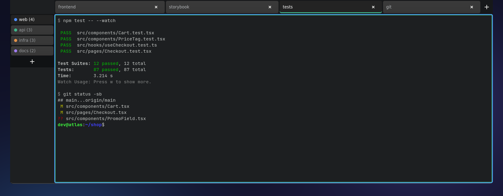
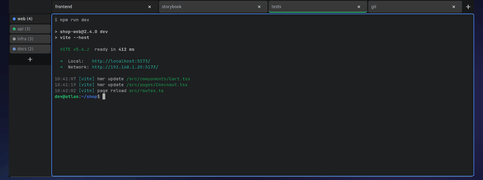
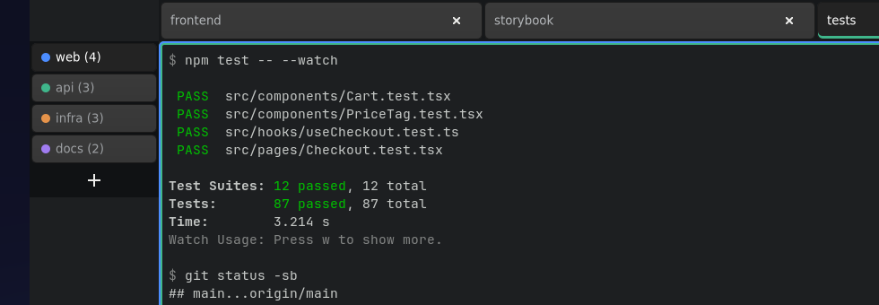
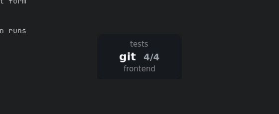
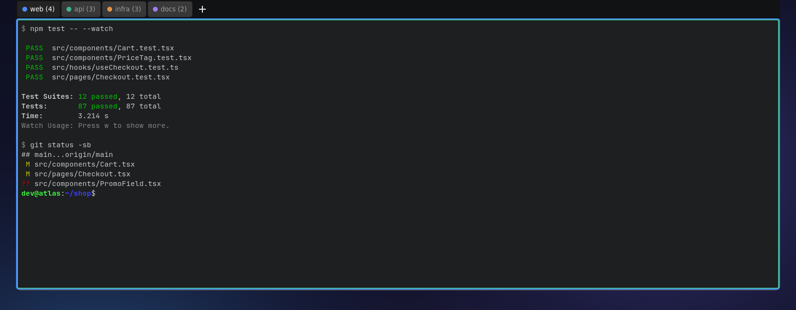
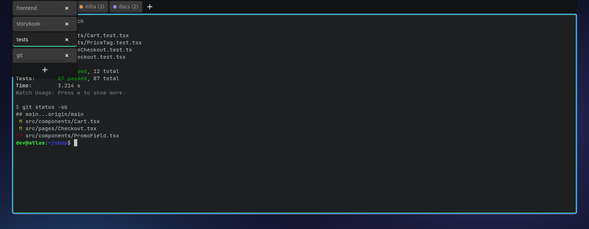
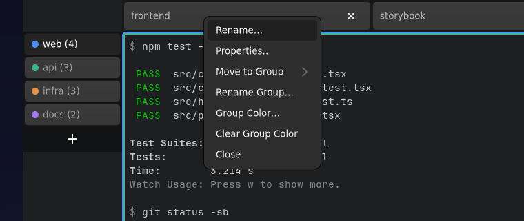
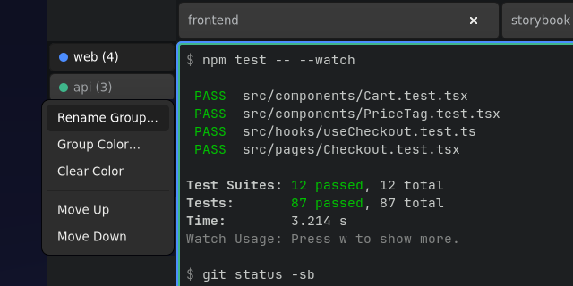

# hashterm

A tmux-native quake terminal for Linux with a two-dimensional tab matrix and
browser-style session resurrection.

Every tab is a session on a **dedicated private tmux server** — the GUI only
attaches. Kill the window, crash it, `kill -9` it: your shells, scrollback and
running programs keep going, and the next launch re-adopts them exactly where
they were.



## Quick start

```sh
sudo apt install libgtk-4-dev libvte-2.91-gtk4-dev libgtk4-layer-shell-dev tmux
cargo build --release
./target/release/hashterm     # then press F12 to drop the console down
```

`Ctrl+Shift+T` opens a tab, `Ctrl+,` opens Settings. Prefer a package? See
[Install](#install).

## Features

- **Quake-style drop-down** — a global hotkey (default `F12`) slides the
  frameless console from the screen edge and keeps it above all other windows.
  X11 (EWMH), wlroots/KDE (layer-shell) and GNOME Wayland (via XWayland, like
  tilda/guake) are all handled; hotkeys go through the desktop portal with
  XGrabKey fallback.
- **Tab matrix** — tabs are organized in two dimensions: *groups* (rows) on
  one window edge, the active group's *terminals* (columns) on the
  perpendicular edge. `Ctrl+PgUp/PgDn` moves between groups, `Ctrl+Home/End`
  between terminals. Groups get colors, drawn as nested accent rings around
  the terminal (outer = group, inner = per-tab accent). Drag a tab onto
  another to reorder, onto a group row to move it there, onto the group bar's
  `+` for a brand-new group. Drag a group row onto another (or right-click >
  Move Left/Right) to reorder groups; the order is remembered.
- **Remembers its window** — size and position are saved when you move or
  resize the window and restored next time (`[window]` in the config; position
  needs X11/XWayland, native Wayland remembers size only).
- **Session resurrection, browser-style** — full dumps capture layout,
  working directories, scrollback and the foreground program of every pane.
  Restores relaunch safe-listed programs (`vim -S` sessions included), and
  pre-type everything else at the prompt so a single `Enter` re-runs it.
  Autosaves rotate on a timer and on exit; named saves never expire.
  `sudo`/`ssh-add`-class commands are never replayed.
- **Settings window *and* a plain config file** — `Ctrl+,` opens a Settings
  window with live preview; it edits `~/.config/hashterm/config.toml` in place
  (your comments survive), and the file stays fully commented and
  live-reloaded on save, so you can still hand-edit or keep it in your
  dotfiles. Hotkey conflicts are detected and surfaced on-screen instead of
  silently picking a winner.
- **Small touches** — per-tab names and accent colors, switch OSD toasts,
  auto-hiding tab bar on any edge, separate terminal/tab-bar/window opacity,
  `Ctrl+Alt+Shift`+scroll live window transparency (remembered across
  restarts), clipboard bridged into tmux copy-mode.

### In motion

Switching tabs (the dial), then hopping between groups — each group has its own
color, tab strip and terminals.



### The tab matrix

Groups run along one edge, the active group's terminals along the perpendicular
one. Each group has a color, drawn as a ring around the terminal; drop a tab on
a group to move it, or on `+` for a new one.



### The switch dial

Switching tabs shows a wheel: the current tab bright in the center, neighbors
receding above and below.



### Auto-hiding tab bar

With `tabbar.auto_hide = true` the bar stays out of the way: it is concealed
until the pointer touches its edge, then slides in **over** the terminal, so
revealing it never reflows the panes. Below, `tabbar.edge = "left"` — first
hidden, then revealed (the terminal text does not move). `Ctrl+Shift+B` toggles
it from the keyboard.




### Settings

`Ctrl+,` opens a Settings window. It applies changes live and edits
`config.toml` in place, keeping your comments, so the file remains the single
source of truth. Details: [docs/settings.md](docs/settings.md).


### Organizing tabs and groups

Right-click a tab to rename it, change its accent color, move it to another
group or close it. Right-click a group to rename it, color it, or move it up and
down (you can also just drag it).




## Install

On Debian-family systems, build the package and install it:

```sh
cargo build --release
./packaging/build-deb.sh
sudo apt install ./dist/hashterm_*.deb
```

Runtime dependencies: GTK 4 (≥ 4.18), VTE4 (≥ 0.80), gtk4-layer-shell, tmux.

### Building from source

```sh
sudo apt install libgtk-4-dev libvte-2.91-gtk4-dev libgtk4-layer-shell-dev
cargo build --release          # needs Rust 1.90+
./target/release/hashterm
```

## Default keys

| Key | Action |
| --- | --- |
| `F12` | toggle the drop-down (global) |
| `Ctrl+Shift+T` / `Ctrl+Shift+W` | new / close tab |
| `Ctrl+Home` / `Ctrl+End` | previous / next terminal in the group |
| `Ctrl+PgUp` / `Ctrl+PgDn` | previous / next group |
| `Alt+1..0` | jump to tab 1–10 |
| `Ctrl+Shift+B` | show/hide the tab bar |
| `Ctrl+Shift+S` | session picker (save / restore) |
| `Ctrl+,` | Settings window |
| `Ctrl+Shift+,` | open `config.toml` in your editor |
| `Ctrl+Shift+C` / `Ctrl+Shift+V` | copy / paste |
| `Ctrl+Alt+Shift` + scroll | window opacity |
| mouse wheel over the tab bar | previous / next tab in the group |
| mouse wheel over a group's title | previous / next tab of *that* group |
| right-click tab / group row | rename, properties, colors, move to group |

Everything is rebindable in `[hotkeys]`.

## Architecture

```
crates/
  hashterm-core       config, persisted UI state, IPC types
  hashterm-tmux       dedicated-server controller, bundled tmux conf, hooks
  hashterm-session    dump/restore engine (zstd scrollback, /proc discovery)
  hashterm-platform   overlay backends (EWMH / layer-shell / plain), hotkeys
  hashterm-ui         GTK4 shell: window, tab bar, group bar, VTE pages
  hashterm            the binary (+ headless dump/restore subcommands)
  hashterm-ctl        tiny helper the tmux hooks call to notify the GUI
```

The tmux server runs on its own socket — `tmux -L hashterm ls` shows your
tabs from any terminal, and everything hashterm knows about a tab (title,
group, colors) lives in tmux session options, so it survives detach, restart
and dump/restore.

## License

MIT — see [LICENSE](LICENSE).
