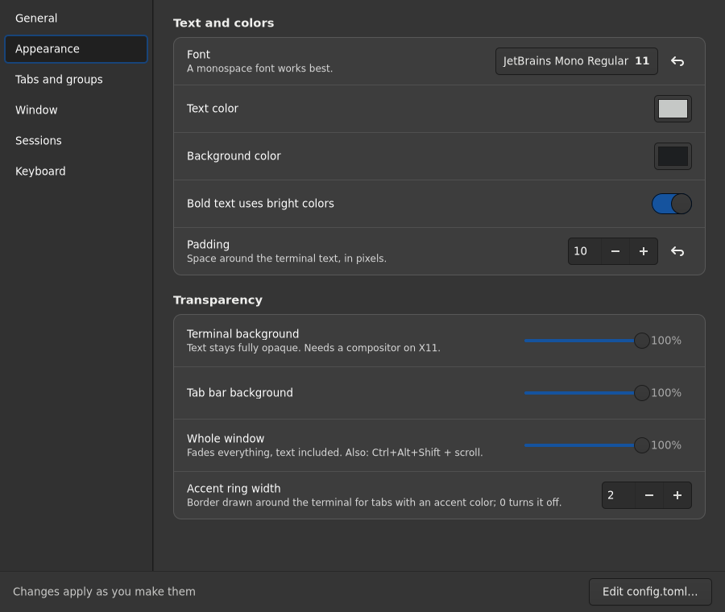
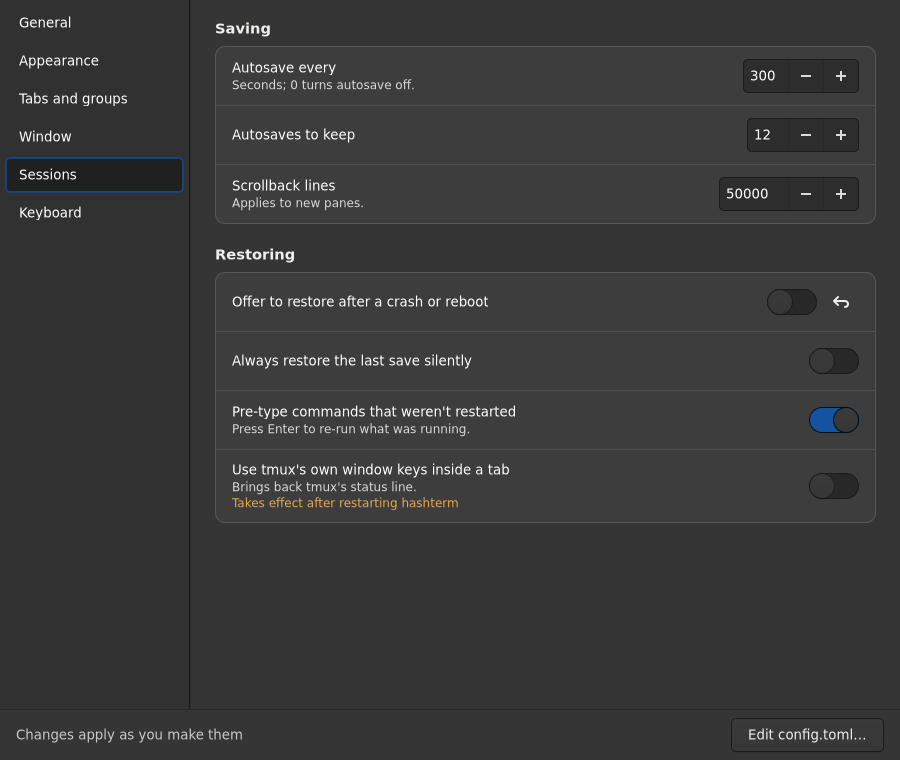
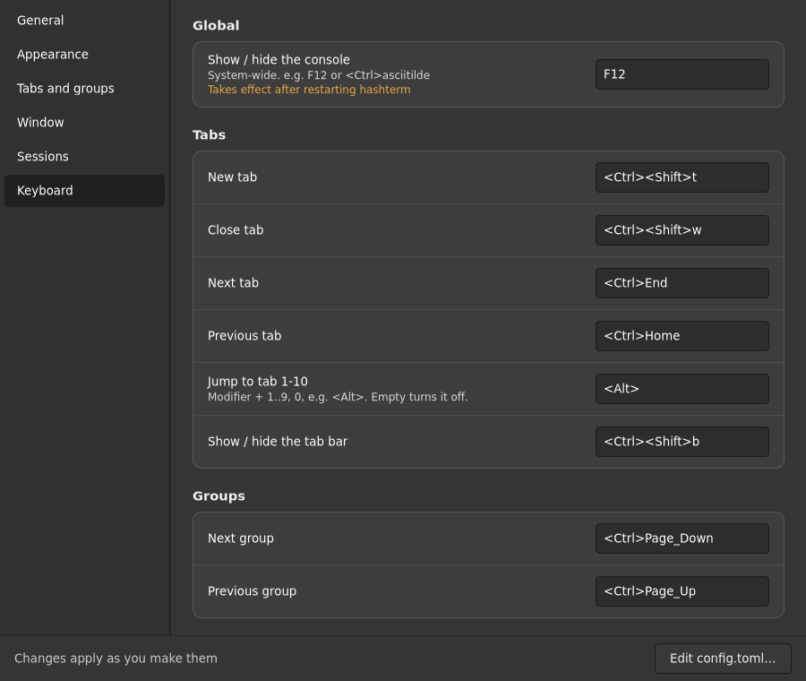

# Settings

Press `Ctrl+,` (or right-click the tab bar → **Settings…**) to open the
Settings window.

Changes apply as you make them — there is no OK or Apply button. Each change is
written to `~/.config/hashterm/config.toml` about half a second later, and
hashterm's normal live-reload picks it up, exactly as if you had edited the file
by hand.

## How it treats your config file

- **Comments and untouched keys are preserved.** Only the keys you change are
  edited, in place; trailing `# comments` on a changed line are kept.
- **Defaults stay out of the file.** A row whose value differs from the built-in
  default shows a reset button; pressing it removes the key, so the default
  applies again.
- **Bad values are refused**, not written: if a change would make the file
  invalid, the status bar says so and `config.toml` is left untouched.
- **A one-time backup** of your original file is kept next to it as
  `config.toml.bak`.
- **Symlinked configs work** (dotfile managers): the real file is edited and
  the link stays a link.
- Options marked *Takes effect after restarting hashterm* are saved
  immediately but only read at startup.

Anything not on these pages (for example `[hotkeys]` extras or `[restore]`
allow-lists) is still available through **Edit config.toml…** at the bottom of
the window.

## Pages

| Page | What is on it |
| --- | --- |
| General | new-tab directory, close behavior, confirm-before-close, start hidden, autostart |
| Appearance | font, colors, padding, terminal / tab bar / window opacity, accent ring width |
| Tabs and groups | tab bar edge, auto-hide, side style, close buttons, switch popup; group bar edge, counts, reordering |
| Window | drop-down edge, size, animation, hide on focus loss, remember size and position, layer-shell options |
| Sessions | autosave interval and retention, scrollback, restore prompts, tmux window keys |
| Keyboard | every global and in-app shortcut (invalid shortcuts are flagged and not saved) |

## Screenshots

